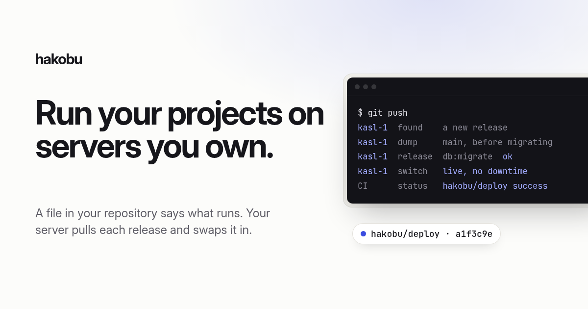

<p align="center">
  <a href="https://hakobu.dev"><picture>
    <source media="(prefers-color-scheme: dark)" srcset="site/og-dark.png">
    
  </picture></a>
</p>

<p align="center">
  <a href="https://github.com/hakobudev/hakobu/releases/latest"></a>
  <a href="https://github.com/hakobudev/hakobu/actions/workflows/ci.yml"></a>
  <a href="LICENSE"></a>
</p>

<p align="center">
  <a href="https://hakobu.dev"><b>hakobu.dev</b></a> ·
  <a href="https://hakobu.dev/docs/">Docs</a> ·
  <a href="https://hakobu.dev/docs/install/">A server</a> ·
  <a href="https://hakobu.dev/docs/project/">A project</a> ·
  <a href="https://github.com/hakobudev/hakobu/releases">Changelog</a>
</p>

---

A project says what it needs in a file in its repository, `hakobu.toml`. CI builds each commit into images; the server pulls the new release, swaps it in with no downtime and sets the commit's status. No panel and no database: the file is the state, and the parts that keep your data safe (deploys, backups, secrets, alerts) are written and tested once, here.

```toml
project = "crm"
server = "kasl-1"

[apps.web]
domain = "crm.example.com"
release = "bin/rails db:migrate"
worker = "bin/jobs"
uses = ["main", "cache"]
volumes = { uploads = "/rails/storage" }

[databases.main]

[caches.cache]
memory = "128mb"
```

```text
your repository ──▶ CI ──▶ a registry ◀── your server
hakobu.toml         hakobu build           pulls each release, deploys it,
Dockerfiles         images, then release   sets the commit's hakobu/deploy status
```

Nothing pushes to the server: it checks the release tag every 30 seconds, so CI needs no access to it, and any CI that can push an image works.

## What you get

**Deploys**

- **Pull deploys.** The server polls a release image and deploys each new one; the commit goes red with the reason if the deploy fails.
- **Safe deploys.** Migrations run in the new image first (a failure leaves the running version alone), the new version takes traffic only once it's healthy, and nothing a deploy does deletes data.
- **Rollback** to the release before, with today's secrets: the server keeps them, no registry needed.

**Data**

- **PostgreSQL databases and Valkey caches**, with passwords made on the server.
- **Secrets in the repository**, each sealed with [age](https://age-encryption.org) to the server and to you: anyone can add one, only the two of you can read it.
- **Backups** of databases and volumes to any S3 bucket and a copy elsewhere, sealed, and restored into scratch after every upload to prove they restore.

**Operations**

- **Alerts** by email when an app is down, a deploy or backup fails, the disk fills, or the audit finds a port or container that shouldn't be there; a pulse to a dead man's switch.
- **Agents welcome, nothing on your laptop.** Each server is its own MCP server, over SSH (`ssh deploy@SERVER mcp`), so an agent sees status and logs, deploys, rolls back and sets a repository up, with a skill for Claude Code; you run the same, `ssh kasl-1 status`. Deleting or restoring data is root's.
- **One Go binary** on the server, rootless Docker, SSH keys that run hakobu's commands alone, signed releases that install themselves. No provider's API is called.

## Start

On a new Debian or Ubuntu server (amd64 or arm64), once, you or your agent:

```bash
ssh root@203.0.113.7 'curl -fsSL https://hakobu.dev/install.sh | HAKOBU_NAME=web-1 HAKOBU_INGRESS=public HAKOBU_ACME_EMAIL=you@example.com bash'
```

It ends with the line that gives your agent the server's MCP:

```bash
claude mcp add --scope user web-1 -- ssh -T deploy@203.0.113.7 mcp
```

Then ask the agent to set a repository up, and push. See [A server](https://hakobu.dev/docs/install/) and [A project](https://hakobu.dev/docs/project/).

## Development

```bash
go build -o hakobu .
just check
```

See [Development](https://hakobu.dev/docs/development/).

## License

[MIT](LICENSE)
